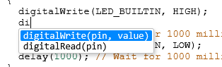
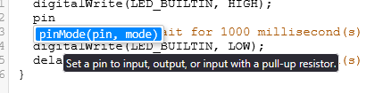

# TinkerCode

Small Firefox-first Arduino autocomplete extension for Tinkercad's CodeMirror 5 editor.

## Screenshots

Arduino function suggestions with parameter signatures as you type:



Hover over a suggestion to see a short description:



## Development

Requires Node.js and npm. Run `npm install`, then `npm run dev`.

Build Firefox: `npm run build`. Build Chrome: `npm run build:chrome`.
Check types: `npm run check`. Run completion tests: `npm test`.

## Load in Firefox

1. Run `npm run build`.
2. Open `about:debugging#/runtime/this-firefox` in Firefox.
3. Choose **Load Temporary Add-on** and select `.output/firefox-mv3/manifest.json`.
4. Reload Tinkercad and open a circuit in Code > Text mode.
5. Type `digitalW`, or use Ctrl+Space after a partial name. Choose with arrows and Enter/Tab; Escape dismisses.

Temporary add-ons are removed when Firefox restarts. Public distribution requires signing.

## Load in Chrome

1. If this is a fresh checkout, run `npm install`.
2. Run `npm run build:chrome`.
3. Open `chrome://extensions` in Chrome.
4. Enable **Developer mode**.
5. Click **Load unpacked** and select the project's `.output/chrome-mv3` folder. Select the folder, not `manifest.json`.
6. Refresh Tinkercad and open a circuit in **Code > Text** mode.

After rebuilding, click **Reload** on TinkerCode's extension card, then refresh Tinkercad. Open TinkerCode from the Extensions menu to customize shortcuts.

## Load in Opera

Opera uses the same Chromium build as Chrome; no separate build command is needed.

1. If this is a fresh checkout, run `npm install`.
2. Run `npm run build:chrome`.
3. Open `opera://extensions` in Opera.
4. Enable **Developer mode**.
5. Click **Load unpacked** (or **Load unpacked extension**) and select the project's `.output/chrome-mv3` folder. Select the folder, not `manifest.json`.
6. Refresh Tinkercad and open a circuit in **Code > Text** mode.

After rebuilding, reload TinkerCode from Opera's Extensions page, then refresh Tinkercad. Open TinkerCode from the Extensions menu to customize shortcuts. Opera compatibility still needs a live browser check; these steps follow [Opera's extension testing instructions](https://help.opera.com/en/extensions/testing/).

## First live checks

Use a disposable circuit. Check `digitalW` and `Serial.pr` suggestions, insertion in the middle of a word, and suppression in strings/comments. Accepting a function inserts its call and selects the first argument. Tab advances, Shift+Tab goes back, and Escape exits placeholder navigation. After the last argument, Tab moves beyond the closing parenthesis. Constants remain plain text; an existing opening parenthesis prevents duplicate parentheses. Constants such as HIGH, LOW, and OUTPUT are suggested inside placeholders. While the dropdown is open, Tab accepts a suggestion; the next Tab navigates arguments. Nested function snippets are not offered inside placeholders. Verify Ctrl+Z restores the previous text. Complete a valid sketch, run the simulation, wait for saving, and reload to confirm persistence. Close/reopen Code and switch boards to check editor remounts.

The real Tinkercad integration still needs these live checks. Unit tests do not establish simulator or saving behavior.

## Design

TypeScript + WXT, Manifest V3, no backend. The page-world script uses Tinkercad's existing CodeMirror instance. Only CodeMirror's MIT-licensed completion add-on and CSS are bundled, not its editor core. Arduino definitions and matching are separate from the adapter. The add-on is generated during npm prepare; its license is in THIRD_PARTY_LICENSE.txt.

No background worker or remote suggestions. Local extension storage is used only for shortcut preferences. The content script runs on www.tinkercad.com and attaches when a CodeMirror editor is mounted. A mutation observer discovers editors without polling. Declaration and scope information is cached per document revision and reused when the cursor moves.

Firefox 128+ is required for MAIN-world content scripts. Chrome has a separate build from the same source. Browser compatibility and site integration need manual verification before release.

## Snippet checks

Complete digitalWrite, replace pin with 13, press Tab, replace value with HIGH, and press Tab to exit. Try Shift+Tab, Escape, deleting a placeholder, and undo. Automated tests use real CodeMirror in jsdom; the test runner exits explicitly because CodeMirror's browser polling timers can outlive the simulated document. Reload the temporary add-on and Tinkercad after rebuilding.


## Completion casing and semicolons

Matching is case-insensitive: DIGITALW completes to digitalWrite, serial.PR to Serial.print, and high to HIGH. Inserted names always use Arduino's canonical casing.

New standalone function calls receive a trailing semicolon, including before a trailing line comment. Existing semicolons and parentheses are preserved. Expression contexts, including multiline assignments and loop headers, do not receive a semicolon. Detection is intentionally conservative; ambiguous contexts may require typing the semicolon manually. The final snippet Tab stop is after the inserted semicolon.


## Sketch variables

Declarations using common Arduino types (int, byte, bool, unsigned long, String, fixed-width integer types, etc.) are suggested, including parameters, pointers, arrays, and comma-separated declarations. Matching is case-insensitive and inserts the declared spelling. Variables are also available inside snippet placeholders; Tab accepts the suggestion before navigating arguments.

Variable suggestions follow lexical scope and declaration order: globals, enclosing block locals, and current-function parameters are available; locals from sibling blocks and other functions are hidden. Inner declarations shadow outer declarations with the same name. Loop and conditional initializer variables stay within their control statement, including unbraced loop bodies and if/else branches. Prototype parameters are excluded. Comments and string contents are ignored. This lightweight scanner supports common Arduino declarations; custom types/aliases, complex C++ declarations, macros, and struct members are not fully resolved.

## Function descriptions

Built-in functions show a short description in a native browser tooltip when hovered. Dropdown rows show only the signature. Descriptions are bundled locally and never inserted into the sketch. Variables and constants remain compact single-line entries.

## Generated completion add-on

src/hint-addon.js is generated by scripts/vendor.mjs from codemirror/addon/hint/show-hint.js (CodeMirror 5.65.21). Its original module wrapper is replaced with an exported installHints function so it can attach to Tinkercad's existing CodeMirror instance. The add-on implementation is otherwise unchanged. It provides the popup and keyboard handling; our own modules provide Arduino definitions, descriptions, variable scanning, and snippet behavior. Do not edit the generated file directly; npm install regenerates it. The MIT license is included in the build.


## Editor hover and shortcuts

Hover over a built-in function name in written code (for example digitalWrite or Serial.println) to see its signature and description as a native browser tooltip. Comments and strings are excluded. Hints recognize supported built-in names, not user-defined overloads.

With the editor focused:

- Ctrl+/ toggles line comments.
- Alt+Shift+Up / Alt+Shift+Down duplicates the current line or selected line block above / below, keeping the cursor or selection on the new copy.
- Alt+Up / Alt+Down moves the current line or selected line block.

Each operation has its own undo step. Shortcuts respect read-only mode and document boundaries. This first version supports a single cursor or contiguous selection; multiple selections are left unchanged. These shortcuts take precedence over browser shortcuts while the editor is focused.


## Customize shortcuts

Open TinkerCode from the browser toolbar or Extensions menu. Click a shortcut field and press the desired combination, then click Save shortcuts. The × button disables an extension binding; Reset defaults stages the original bindings until you save. Preferences are saved locally and applied to open Tinkercad editors. Duplicate combinations and core editing shortcuts are rejected. Browser/OS-reserved keys may remain unavailable. Disabling a TinkerCode binding does not remove Tinkercad's own bindings.

The settings popup and isolated content script access extension storage. A validated, settings-only message passes shortcut values to the page-world editor adapter; page messages cannot write extension storage. No sketch code is sent through this bridge.


## Loop snippets and type completion

Type `fo` or `for`, then accept the loop suggestion to insert:

```cpp
for (int i = 0; i < count; i++) {

}
```

Tab moves through initialization, condition, increment, and the body. Shift+Tab moves back; Escape ends navigation. Replace `count` with your loop limit. Each header section is independently editable: if you rename `i`, update the other sections too. The snippet follows the editor's indentation settings and keeps existing parentheses when completing a loop already being written. Nested snippet expansion is available after leaving the current snippet.

Type suggestions include `int`, `char`, `double`, `float`, `bool`, `byte`, `short`, `long`, `unsigned`, `signed`, `void`, `String`, `size_t`, and fixed-width integer types. Matching is case-insensitive and inserts the correct spelling. Types are available inside snippet placeholders as well.

## Select whole lines

Alt+L selects the current line, including its newline when present. Press it again to extend the selection to the next line. The final line is selected through its last character. You can change or disable this binding in the shortcut popup. Existing saved shortcut preferences are preserved when this new action is added; if Alt+L is already assigned, the new action starts disabled to avoid a collision.

## Control-flow snippets

Accept `if`, `ifelse`, `else`, `while`, or `switch` from autocomplete to insert an indented block. `ifelse` expands into an if/else pair. Tab and Shift+Tab navigate conditions, case values, and empty body stops; Escape exits. The switch template includes one case, a default branch, and break statements. These snippets also accept uppercase input. Complete or exit the current snippet before expanding another block.

## Sketch-function autocomplete

Ordinary functions declared or defined at sketch scope appear in suggestions with their parameter types. For example, `void blink(int pin, unsigned long duration)` produces a `blink(int pin, unsigned long duration)` suggestion and inserts `blink(pin, duration)` with editable argument stops. Existing parentheses are preserved; standalone calls receive a semicolon, while expression calls do not. Matching ignores case and inserts the declared spelling. Functions and variables share a cached index. It refreshes after a 120 ms typing pause or on the next hint request after an edit, keeping scope positions current. Cursor-only requests reuse the cache.

Prototypes and matching definitions are deduplicated, and overloads with different parameter types remain available. Empty and `(void)` parameter lists insert empty calls; unnamed parameters use `arg1`, `arg2`, etc. Default argument values are omitted from the inserted call so each argument can be edited. This lightweight scanner supports ordinary free functions; templates, class/namespace members, and function-pointer parameters are outside its current scope. Nested function snippets remain disabled while another snippet is active.

## Scope-aware variable checks

In two functions with different parameters and locals, each function should suggest only its own variables plus earlier globals. Check nested blocks, a for-loop counter inside and after the loop, and a local name shadowing a global. Moving the cursor between functions updates visibility immediately. Editing braces also refreshes scope information on the next hint request. Incomplete sketches are handled as a best effort; advanced constructs such as templates, class/namespace members, lambda captures, and preprocessor branches are not fully analyzed.
